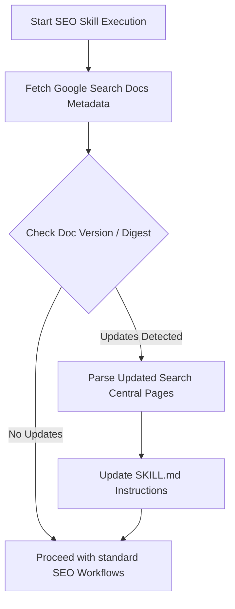

# Complete SEO Agent Skill (Google Search Central, GEO/AEO & Open-SEO Integration)

This skill equips the AI agent with end-to-end expertise in Search Engine Optimization (SEO), Generative Engine Optimization (GEO), Answer Engine Optimization (AEO), and Agentic Web standards (`llms.txt`), adhering strictly to **Google Search Central official documentation** and utilizing **Open-SEO** (`every-app/open-seo`) for programmatic auditing, keyword tracking, competitor intelligence, and project upgrades.

---

## 1. Google Search Central Core Architecture & Guidelines

### 1.1 Search Essentials (Formerly Webmaster Guidelines)
Google Search Essentials outline the fundamental requirements to make content discoverable and indexable by Google:
- **Technical Requirements**:
  - The page must return an HTTP `200 OK` status code to Googlebot.
  - The page must not be blocked by `robots.txt` or a `noindex` tag.
  - The page must contain indexable text content (HTML or rendered JavaScript DOM).
- **Spam Policies**:
  - Strictly avoid Cloaking, Doorway pages, Hacked content, Hidden text/links, Keyword stuffing, Link spam, Machine-generated spam without value, Misleading redirects, and Scraped content.
- **Key Best Practices**:
  - Create useful, reliable, people-first content (E-E-A-T).
  - Ensure links are crawlable `<a href="...">` elements.
  - Optimize page load speeds and Core Web Vitals.

---

### 1.2 Crawling and Indexing Deep-Dive

#### A. Robots.txt Management
- Place `robots.txt` at the root domain (`https://example.com/robots.txt`).
- Standard directive structure including search engine crawlers and AI search bots:
  ```text
  User-agent: *
  Disallow: /admin/
  Disallow: /api/
  Disallow: /tmp/
  Allow: /public/

  User-agent: Googlebot
  Disallow: /private/

  # Allow AI Search Crawlers (GEO / AEO)
  User-agent: GPTBot
  Allow: /

  User-agent: PerplexityBot
  Allow: /

  User-agent: ClaudeBot
  Allow: /

  User-agent: Google-Extended
  Allow: /

  User-agent: DeepSeekBot
  Allow: /

  Sitemap: https://example.com/sitemap.xml
  ```
- **Rule**: Never use `robots.txt` to block indexing of confidential sensitive pages (use HTTP authentication or `noindex` meta tag instead).

#### B. XML Sitemaps
- Sitemap index file format referencing child sitemaps (max 50,000 URLs or 50MB uncompressed per sitemap file):
  ```xml
  <?xml version="1.0" encoding="UTF-8"?>
  <urlset xmlns="http://www.sitemaps.org/schemas/sitemap/0.9"
          xmlns:image="http://www.google.com/schemas/sitemap-image/1.1">
    <url>
      <loc>https://example.com/page-1</loc>
      <lastmod>2026-10-03T12:00:00Z</lastmod>
      <changefreq>weekly</changefreq>
      <priority>0.8</priority>
    </url>
  </urlset>
  ```
- Include only canonical, HTTP 200 URLs in sitemaps.

#### C. Meta Tags & HTTP Headers
- **Robots Meta Tag**:
  ```html
  <meta name="robots" content="index, follow, max-snippet:-1, max-image-preview:large, max-video-preview:-1">
  ```
- **X-Robots-Tag HTTP Header** (for PDF, API, images):
  ```http
  X-Robots-Tag: noindex, nofollow
  ```

#### D. Canonicalization (`rel="canonical"`)
- Consolidate duplicate or near-duplicate URLs:
  ```html
  <link rel="canonical" href="https://example.com/canonical-url">
  ```
- Absolute URLs are required. Ensure cross-domain canonicals match HTTP vs HTTPS and `www` vs non-`www`.

#### E. Redirects & HTTP Status Codes
- **301 Moved Permanently**: Permanent redirection; passes link equity / PageRank.
- **302 Found / 307 Temporary Redirect**: Temporary redirection; target URL won't immediately replace source in index.
- **404 Not Found / 410 Gone**: Signal removed pages. Use 410 for intentional permanent removals.
- **503 Service Unavailable**: Temporary server maintenance signal to prevent de-indexing.

#### F. JavaScript SEO & Dynamic Rendering
- **Googlebot Execution**: Googlebot uses a modern Chromium rendering engine. It executes JavaScript, but rendering can be delayed in a secondary indexing queue.
- **SSR / Hydration Guidelines**:
  - Prefer Server-Side Rendering (SSR) or Static Site Generation (SSG) for key SEO pages.
  - Avoid rendering critical content or links exclusively via asynchronous user events (e.g., click handlers).
  - Ensure links use standard `<a href="...">` syntax rather than JavaScript `onClick` routes.
  - Return distinct HTTP status codes (e.g., 404) directly from server responses, rather than rendering client-side error states on 200 OK pages ("soft 404").

---

### 1.3 Ranking & Search Appearance

#### A. Title Tags (`<title>`) & Meta Descriptions
- Title links: Keep titles concise (50-60 characters), unique per page, including target keywords naturally:
  ```html
  <title>Primary Keyword - Brand Name or Contextual Descriptor</title>
  ```
- Meta Descriptions: Concise summary (120-155 characters) acting as organic search snippet copy:
  ```html
  <meta name="description" content="Clear, compelling summary containing target keywords and call to action.">
  ```

#### B. Structured Data (Schema.org via JSON-LD)
- Embed Structured Data inside `<script type="application/ld+json">`:
  - **Organization / WebSite (with Brand Entity links)**:
    ```json
    {
      "@context": "https://schema.org",
      "@type": "Organization",
      "name": "Example Corp",
      "url": "https://example.com",
      "logo": "https://example.com/logo.png",
      "sameAs": [
        "https://twitter.com/example",
        "https://www.linkedin.com/company/example",
        "https://www.wikidata.org/wiki/Q12345"
      ]
    }
    ```
  - **Article / TechArticle**:
    ```json
    {
      "@context": "https://schema.org",
      "@type": "TechArticle",
      "headline": "SEO Best Practices Guide",
      "author": { "@type": "Person", "name": "SEO Specialist" },
      "datePublished": "2026-10-03",
      "inLanguage": "en"
    }
    ```
  - **FAQPage**:
    ```json
    {
      "@context": "https://schema.org",
      "@type": "FAQPage",
      "mainEntity": [
        {
          "@type": "Question",
          "name": "How does GEO differ from traditional SEO?",
          "acceptedAnswer": {
            "@type": "Answer",
            "text": "Generative Engine Optimization (GEO) focuses on getting cited and recommended in AI-generated answers, whereas traditional SEO focuses on ranking blue links on SERP pages."
          }
        }
      ]
    }
    ```

#### C. Visual Elements & Media Optimization
- **Favicon**: Provide a square favicon matching multiples of 48px (`48x48`, `96x96`, `192x192`).
  ```html
  <link rel="icon" href="/favicon-48x48.png" sizes="48x48">
  ```
- **Images**: Descriptive `alt` tags, WebP/AVIF formats, `loading="lazy"` for below-the-fold images, responsive `srcset`.
- **Videos**: Provide `VideoObject` structured data, video sitemap, poster image, accessible transcript.

---

### 1.4 Technical SEO & Core Web Vitals

#### Core Web Vitals Thresholds
- **LCP (Largest Contentful Paint)**: Good $\le 2.5\text{s}$. Measures loading performance.
- **INP (Interaction to Next Paint)**: Good $\le 200\text{ms}$. Measures page responsiveness.
- **CLS (Cumulative Layout Shift)**: Good $\le 0.1$. Measures visual stability.

#### Technical Optimization Checklist
1. **HTTPS Enforcement**: 100% TLS/SSL certificate coverage with HTTP to HTTPS 301 redirects.
2. **Mobile-First Indexing**: Page layout, DOM structure, metadata, and content must be identical on mobile and desktop viewports.
3. **Internal Link Hierarchy**: Logical site architecture with clean breadcrumb paths and internal links passing PageRank.

---

### 1.5 Content & Experience (E-E-A-T)

- **E-E-A-T**: Experience, Expertise, Authoritativeness, Trustworthiness.
- **Helpful Content System**: Focus on primary user intent, original insights, verified facts, author disclosures, and clear publishing information.
- **Topical Authority**: Organize content into Pillar Pages and Supporting Cluster Pages linked bidirectionally.
- **Internationalization (`hreflang`)**:
  ```html
  <link rel="alternate" hreflang="en" href="https://example.com/en/page" />
  <link rel="alternate" hreflang="es" href="https://example.com/es/page" />
  <link rel="alternate" hreflang="x-default" href="https://example.com/en/page" />
  ```

---

### 1.6 Generative Engine Optimization (GEO) & Answer Engine Optimization (AEO)

As AI models (Google AI Overviews, ChatGPT Search, Perplexity, Claude, DeepSeek, Bing Copilot) synthesize answers directly, **GEO** and **AEO** maximize a brand's **Share of Model (SoM)** and citation rate.

#### A. Information Gain Score Optimization
- **Net-New Value**: Content must provide unique statistics, proprietary benchmarks, first-hand case studies, or expert quotes rather than rehashing existing SERP results.
- **The Gap Audit**: Identify missing nuances (exact costs, specific risks, edge cases) in competitor content and explicitly answer them.

#### B. Passage Extractability & Claim-Evidence Formatting
- **The 40–50 Word Rule**: Begin sub-sections under `##` or `###` headings with a bold, self-contained 40–50 word summary statement answering the heading query directly.
- **Claim-Evidence Structure**: State claims clearly followed by verifiable data, exact numbers, or cited sources.
- **Bullet-Point Logic**: Use structured lists and Markdown HTML tables (`<table>`) for complex comparisons; LLM parsers extract structured tables significantly faster than dense prose.

#### C. Brand Entity Verification & Earned Media
- Ensure brand details (Name, Founder, Address, Product Line) are aligned across third-party sources (Wikidata, Wikipedia, Crunchbase, official directories). Over 80% of AI citations stem from third-party earned media verification.

---

### 1.7 The Agentic Web & `llms.txt` / `llms-full.txt` Standard

`llms.txt` is the open standard for guiding LLMs, AI search agents, and developer tools through a website's high-value content cleanly and without token overhead.

#### A. Standard Specification (`/llms.txt`)
- Located at domain root: `https://example.com/llms.txt`.
- Format: CommonMark Markdown.
- Structure:
  ```markdown
  # Site or Project Name

  > Brief blockquote summary describing the organization, product, or documentation hub in 1-2 sentences.

  ## Core Documentation
  - [Getting Started](https://example.com/docs/start): Quickstart guide for installation and setup.
  - [API Reference](https://example.com/docs/api): Complete REST API specification.

  ## Main Products
  - [Product Overview](https://example.com/products): Features and pricing details.

  ## Optional Full Export
  - [Full Documentation](https://example.com/llms-full.txt): Complete un-truncated documentation text.
  ```

#### B. Discovery via HTML Head Tag & HTTP Header
- Declare `llms.txt` in `<head>`:
  ```html
  <link rel="describedby" href="/llms.txt" type="text/markdown" />
  ```
- Or via HTTP Response Header:
  ```http
  Link: </llms.txt>; rel="describedby"; type="text/markdown"
  ```

---

### 1.8 Critical SEO Failure Patterns & Mandatory Audit Factors (Learned Guardrails)

When diagnosing why a website is invisible or underperforming on Google Search, the agent MUST explicitly audit and verify these 6 critical failure points:

#### 1. Exact-Match Lexical & Quoted Search Verification
- **The Issue**: When users search with quotation marks, search engines enforce strict exact-match keyword matching. If the site only uses synonyms, engines eliminate or demote the page.
- **Rule**: The agent MUST audit public, indexable HTML (titles, meta descriptions, headings, body text, noscript) to confirm that target search keywords, their exact phrases, and all common lexical variants explicitly exist in the markup.

#### 2. Root Homepage (`/`) & Core Hub SSR / Pre-Rendering Coverage
- **The Issue**: In Single Page Applications (React, Vue, Vite, Svelte), developers often configure Server-Side Rendering (SSR) for dynamic subroutes, but leave root homepage `/` mapped to a raw `index.html` with an empty `<div id="root"></div>`.
- **Rule**: Root `/` and all major hubs MUST be server-rendered (SSR) or pre-rendered (SSG) with full localized semantic HTML, titles, meta tags, schema blocks, and `<noscript>` fallbacks.

#### 3. Dedicated Transactional Pillar Landing Pages for Core USPs
- **The Issue**: Search engines rank dedicated, high-intent landing pages higher than generic homepages for specific transactional queries.
- **Rule**: Every unique business capability and payment method MUST have a dedicated, indexable pillar landing page (e.g. `/crypto-payment`, `/installments`, `/b2b-wholesale`).

#### 4. Semantic H1 & Heading Language Alignment
- **The Issue**: Using abstract marketing slogans in the primary `<h1>` on a localized website strips the page of its topical niche entity.
- **Rule**: The primary `<h1>` and `<h2>` headings MUST contain high-volume commercial keywords in the target audience's language.

#### 5. Structured Data (Schema.org) Completeness for Payments & FAQs
- **The Issue**: Minimal JSON-LD schemas that omit accepted currencies or fail to provide structured FAQs lose rich snippet positions and AI Overview citations.
- **Rule**: eCommerce schemas (`Store`, `Product`) must explicitly declare `currenciesAccepted` and `paymentAccepted`. All pillar pages must embed `FAQPage` JSON-LD schemas.

#### 6. Internal Anchor Text Navigation & Link Equity Distribution
- **The Issue**: Search engines rely on crawlable `<a href="...">` anchor text to discover pages and associate keyword relevance.
- **Rule**: High-priority landing pages must be linked directly in `<header>` and `<footer>` navigation using explicit descriptive anchor text.

#### 7. Strict Sitemaps.org Schema Compliance & Prevention of Identical Self-Referential Alternate URLs
- **The Issue**: Developers frequently copy `xhtml:link` hreflang snippets into `sitemap.xml` where multiple languages point to the exact same URL (e.g. `fa`, `en`, and `x-default` all referencing `https://example.com/` without language path subdirectories). Google Search Console strictly rejects this with **"Sitemap could not be read"** / **"Invalid hreflang tag: alternate URL must be unique"**.
- **Rule**: In single-page applications (SPAs) or projects without language-specific URL subpaths (like `/en/`, `/fa/`), NEVER generate duplicate `xhtml:link` alternates pointing to identical URLs. Always generate clean, standard `<loc>` entries conforming strictly to the `sitemaps.org/schemas/sitemap/0.9` schema.

#### 8. XML Sitemap Purity (Zero Comments inside `<urlset>`)
- **The Issue**: Adding explanatory XML comments (e.g. `<!-- Homepage -->`, `<!-- Courses -->`) between `<url>` elements causes strict search engine XML parsers (Googlebot, Bingbot) to throw parser warnings or fail to index the sitemap properly.
- **Rule**: XML sitemaps must remain 100% pure XML data containing only standard `<urlset>` and `<url>` child nodes (`<loc>`, `<lastmod>`, `<changefreq>`, `<priority>`) without comments or non-standard wrappers.

#### 9. Google Search Console Relative Path Submission Directive
- **The Issue**: In the Google Search Console UI under **Indexing → Sitemaps**, the input field already prepends the domain prefix (e.g. `https://example.com/`). If the user or agent enters the full URL `https://example.com/sitemap.xml`, GSC attempts to fetch `https://example.com/https://example.com/sitemap.xml`, which fails immediately with "Couldn't fetch" or "Sitemap could not be read".
- **Rule**: The agent and UI instructions must explicitly instruct to enter ONLY the relative path (e.g. `sitemap.xml`).

#### 10. Multi-Project Shared SEO Service Account Protocol & Verified Credentials
- **The Issue**: Manual verification, UI sitemap submission, and copy-pasting measurement IDs across projects causes repetitive manual friction and permission bottlenecks.
- **Verified Infrastructure**: The user has an existing, production-verified Google Cloud Service Account configured specifically for autonomous SEO operations:
  - **Service Account Email**: `agent-seo@metal-appliance-451418-h0.iam.gserviceaccount.com`
  - **GCP Project**: `metal-appliance-451418-h0`
  - **Primary Key Location**: `C:\Users\PC\prj\berim-gear-hub\gsc-credentials.json`
  - **Supported APIs**: Google Search Console API (`webmasters`), Google Indexing API (`indexing`), and Google Analytics Admin API (`analyticsadmin`).
- **Rule**: For any new project or domain, the agent checks for or copies `gsc-credentials.json`. When the user adds `agent-seo@metal-appliance-451418-h0.iam.gserviceaccount.com` once as an **Owner** in Google Search Console (Settings → Users and permissions), the agent can autonomously manage properties, submit sitemaps, notify Googlebot of updates, and extract search analytics via CLI/scripts without manual steps.

---

### 1.9 Google Search Console (GSC) API Automation & Real-Time Search Analytics Engine

Google Search Console is the authoritative ground truth for how Google crawls, indexes, and ranks a website. The agent integrates directly with the Google Search Console (Webmasters v3) API and Google Indexing API.

#### A. Service Account Authentication & Site Ownership
- **Authentication**: Uses a GCP Service Account with OAuth2 JWT (RSA-SHA256 signature) exchanging claims for a scoped access token (`token_uri`).
- **Required API Scopes**:
  - `https://www.googleapis.com/auth/webmasters` (manage properties and sitemaps)
  - `https://www.googleapis.com/auth/webmasters.readonly` (query Search Analytics)
  - `https://www.googleapis.com/auth/indexing` (submit real-time indexing notifications)
- **Dual-Layer Ownership Verification**:
  1. **DNS TXT Record**: Domain-level verification (`google-site-verification=<token>`) for `sc-domain:<domain>`.
  2. **HTML Meta Tag**: In `<head>`: `<meta name="google-site-verification" content="<token>" />`. Both should be maintained simultaneously so domain ownership never drops if DNS caches or CDN proxies fluctuate.

#### B. Automated Sitemap Submission & Property Management
- Query registered properties: `GET https://www.googleapis.com/webmasters/v3/sites`.
- Programmatically submit dynamic sitemaps:
  ```http
  PUT https://www.googleapis.com/webmasters/v3/sites/{encodedSiteUrl}/sitemaps/{encodedSitemapUrl}
  Authorization: Bearer {token}
  ```

#### C. Real-Time Indexing Notifications (Google Indexing API)
- Notify Googlebot immediately when new products, pillar articles, or core pages are updated or published:
  ```http
  POST https://indexing.googleapis.com/v3/urlNotifications:publish
  Authorization: Bearer {token}
  Content-Type: application/json

  {
    "url": "https://example.com/target-page",
    "type": "URL_UPDATED"
  }
  ```

#### D. Search Analytics Extraction & Performance Mining
- Endpoint: `POST https://www.googleapis.com/webmasters/v3/sites/{encodedSiteUrl}/searchAnalytics/query`.
- Extract metrics: `impressions`, `clicks`, `ctr`, and `position` grouped by dimensions `query`, `page`, `device`, `country`, and `date`.
- **Actionable Optimization Heuristics**:
  - **High Impressions + Low CTR (Position 1–10)**: Refactor `<title>` tags and meta descriptions with stronger commercial call-to-actions.
  - **Target Keywords at Position 11–30 (Page 2–3)**: Build internal link clusters, add structured FAQ schema, or expand semantic body copy.
  - **Zero-Impression Commercial Targets**: Identify missing terms and generate dedicated landing pages.
- **Persistence**: Save search analytics snapshots locally (e.g. `data/db/gsc-analytics.json`) to track ranking velocity over time.

---

### 1.10 Google Analytics 4 (GA4) SPA Integration & Client-Side Measurement

In Single Page Applications (SPAs built with React Router, Next.js, Vue, Svelte), standard `<script async src="gtag/js?id=G-XXXXX">` snippets fail to record user navigation because internal route transitions do not trigger full browser page reloads.

#### A. Architecture & Dynamic Loader
- Centralize analytics logic in a dedicated client module (`src/lib/analytics.ts`).
- Dynamically inject `gtag.js` when `VITE_GA_MEASUREMENT_ID` or `NEXT_PUBLIC_GA_ID` is present.
- Set `send_page_view: false` in the initial config to prevent duplicate pageviews on the initial load.

#### B. SPA Route Change Listener
- In the root router, trigger pageviews on location change:
  ```ts
  window.gtag('event', 'page_view', {
    page_title: document.title,
    page_location: window.location.href,
    page_path: location.pathname + location.search,
  });
  ```

---

## 2. Automated Documentation Recheck Protocol

To keep instructions synchronized with Google Search Central updates, the agent executes this protocol upon invoking the SEO skill or running audits:



### Recheck Procedure Instructions for Agent:
1. **HTTP GET** `https://developers.google.com/search/docs` & key sublinks:
   - `https://developers.google.com/search/docs/essentials`
   - `https://developers.google.com/search/docs/crawling-indexing/javascript/javascript-seo-basics`
   - `https://developers.google.com/search/docs/appearance/title-link`
2. **Check for New Directives or Deprecations**: Look for updated meta tag rules, Core Web Vitals metric additions, or structured data additions.
3. **Self-Update**: If changes are identified, update `SKILL.md` (both in global config and local repo) to record the new specifications before executing project fixes.

---

## 3. Open-SEO Integration (`every-app/open-seo`)

Open-SEO is an open-source, pay-as-you-go alternative to Semrush and Ahrefs that provides an MCP server and CLI/API integration.

### 3.1 Setup & Architecture
- **Data Engine**: DataForSEO API.
- **MCP Server Connection**: Integrates with AI agents (Antigravity, Claude Code, etc.) via OpenSEO MCP.
- **Self-Hosting Options**:
  - **Docker**: `docker compose up -d` using `compose.yaml`.
  - **Cloudflare**: Deployed to Cloudflare Workers with D1/Hyperdrive database.

### 3.2 Key Open-SEO Workflows

#### 1. Technical Site Audit
- Crawl target domain to identify:
  - Broken links (404/500 errors)
  - Missing title tags, meta descriptions, or H1 headings
  - Duplicate content & canonical mismatches
  - Unoptimized images and slow response times

#### 2. Keyword Research & Volume Analysis
- Query DataForSEO endpoint via Open-SEO MCP/API:
  - Extract search volume, keyword difficulty (KD), CPC, and SERP feature presence.
  - Identify long-tail keyword opportunities and search intent classification (Informational, Navigational, Commercial, Transactional).

#### 3. Rank Tracking & SERP Monitoring
- Track keyword positions across target locations, languages, and device types (Desktop vs Mobile).
- Monitor SERP features (Featured Snippets, Knowledge Panels, People Also Ask, Local Pack).

#### 4. Backlink Analysis & Authority
- Inspect backlink profiles:
  - Referring domains, total backlinks, anchor text distribution, dofollow vs nofollow ratio.
  - Identify toxicity and toxic backlink disallow opportunities.

#### 5. Competitor Keyword & Content Gap Analysis
- Compare target project domain against top 3 competitors:
  - Uncover ranking keywords competitors hold that the current project lacks.
  - Discover content gaps and strategic keyword target candidates.

#### 6. AI Search Visibility & LLM Share of Model (GEO Audit)
- Evaluate site representation in AI Search platforms (Perplexity, SearchGPT, Google Gemini AI Overviews, Copilot):
  - Ensure brand entities and core content are indexable by AI crawlers (`GPTBot`, `PerplexityBot`, `ClaudeBot`, `Google-Extended`, `DeepSeekBot`).
  - Audit presence of `/llms.txt` and passage extractability for LLM RAG ingestion.

---

## 4. End-to-End Project SEO Audit & Upgrade Protocol

When the user asks to analyze or upgrade a project using the SEO skill, the agent follows this 6-step automated workflow:

### Step 1: Initial Codebase Scan & Setup Check
- Inspect project files:
  - Check HTML templates (`index.html`, Next.js `layout.tsx`/`page.tsx`, Vite, React, Vue, Svelte, Astro).
  - **Google Verification Check**: Confirm `<meta name="google-site-verification" content="..." />` is present in `<head>`.
  - **Google Analytics 4 (GA4) Check**: Verify `gtag.js` or client tracking module (`src/lib/analytics.ts`) is installed and hooked into the SPA router.
  - **Agentic Standard Check**: Verify presence of `public/llms.txt` and `<link rel="describedby" href="/llms.txt" type="text/markdown">` in `<head>`.
  - Verify `public/robots.txt` and `public/sitemap.xml`.
  - Inspect head tags, meta titles, descriptions, canonical tags, open graph metadata, and JSON-LD schema blocks.

### Step 2: Google Search Console (GSC) API Automation & Search Analytics Mining
- When Google Service Account credentials exist (`gsc-credentials.json` or environment credentials):
  1. Authenticate with Google Search Console v3 API.
  2. Verify registered site properties (`https://example.com/`, `sc-domain:example.com`).
  3. Submit dynamic XML sitemap to all properties.
  4. Ping Google Indexing API for newly published or updated URLs.
  5. Extract 30-day Search Analytics performance data and persist snapshot to `data/db/gsc-analytics.json`.

### Step 3: Open-SEO Audit & GEO Evaluation Execution
- Run Open-SEO audit tool or endpoint against target URL / local preview server:
  - Gather site health score, broken links, missing meta tags, Core Web Vitals signals, keyword ranking baseline, and AI search crawler accessibility.

### Step 4: Issue Diagnosis & Prioritization
Classify issues into priority tiers:
1. **Critical (P0)**: Blocked crawling (`robots.txt`), `noindex` on main pages, blocked AI crawlers (`GPTBot`, `PerplexityBot`), broken canonicals, missing titles, major 404s, unhandled 500 errors.
2. **High Impact (P1)**: Missing meta descriptions, non-semantic HTML (`<div>` instead of `<h1>`/`<article>`), missing alt attributes, absent structured data (JSON-LD), absent `/llms.txt`, slow LCP/INP image formats.
3. **Optimization (P2)**: OpenGraph/Twitter social cards, breadcrumb schemas, sitemap priority tuning, passage optimization (40-50 word answer blocks).

### Step 5: Automated Code Upgrades & Fixes
- Apply standard code upgrades directly in project source code.

#### Example: `public/llms.txt` Generator / Template
```markdown
# Brand Name

> Comprehensive solution for product or service.

## Key Links
- [Homepage](https://example.com/): Official homepage and feature overview.
- [Documentation](https://example.com/docs): Technical documentation and guides.
- [Pricing](https://example.com/pricing): Pricing plans and features.
```

#### Example: Next.js App Router (`layout.tsx` / `page.tsx`)
```tsx
import type { Metadata } from 'next';

export const metadata: Metadata = {
  title: 'Optimized Title | Brand Name',
  description: 'Comprehensive, keyword-rich meta description summarizing page content.',
  alternates: {
    canonical: 'https://example.com/target-page',
  },
  openGraph: {
    title: 'Optimized Title',
    description: 'Meta description for social sharing',
    url: 'https://example.com/target-page',
    siteName: 'Brand Name',
    images: [{ url: 'https://example.com/og-image.jpg', width: 1200, height: 630 }],
    type: 'website',
  },
  twitter: {
    card: 'summary_large_image',
    title: 'Optimized Title',
    description: 'Meta description',
    images: ['https://example.com/og-image.jpg'],
  },
  robots: {
    index: true,
    follow: true,
    googleBot: {
      index: true,
      follow: true,
      'max-video-preview': -1,
      'max-image-preview': 'large',
      'max-snippet': -1,
    },
  },
};
```

#### Example: HTML / Vanilla JS / React Head Tags
```html
<head>
  <meta charset="UTF-8" />
  <meta name="viewport" content="width=device-width, initial-scale=1.0" />
  <title>Optimized Page Title | Brand</title>
  <meta name="description" content="Engaging meta description under 155 characters." />
  <link rel="canonical" href="https://example.com/current-page" />
  <link rel="describedby" href="/llms.txt" type="text/markdown" />

  <!-- OpenGraph -->
  <meta property="og:title" content="Optimized Page Title" />
  <meta property="og:description" content="Engaging meta description" />
  <meta property="og:url" content="https://example.com/current-page" />
  <meta property="og:type" content="website" />
  <meta property="og:image" content="https://example.com/og-image.jpg" />

  <!-- Structured Data -->
  <script type="application/ld+json">
  {
    "@context": "https://schema.org",
    "@type": "WebSite",
    "name": "Brand Name",
    "url": "https://example.com"
  }
  </script>
</head>
```

#### Example: `public/robots.txt`
```text
User-agent: *
Allow: /

# Allow Search Engine & AI Search Crawlers
User-agent: Googlebot
Allow: /

User-agent: GPTBot
Allow: /

User-agent: PerplexityBot
Allow: /

User-agent: ClaudeBot
Allow: /

User-agent: Google-Extended
Allow: /

User-agent: DeepSeekBot
Allow: /

Sitemap: https://example.com/sitemap.xml
```

### Step 6: Post-Upgrade Recheck & Verification
1. **Validation**: Re-verify DOM head tags, syntax of JSON-LD schemas, XML sitemap validation, `llms.txt` CommonMark syntax, and robots.txt syntax.
2. **Audit Verification**: Run Open-SEO re-audit to verify resolved issues and report health score improvements to the user.
